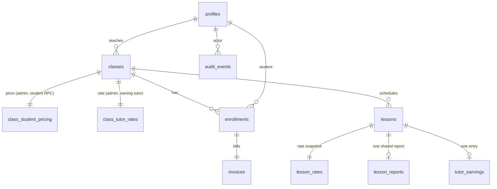

# Architecture

## Data model

## Responsibilities

- **Database:** all rules that must hold on every path: constraints, RLS, column grants, triggers, and the transactional functions `enroll`, `mark_invoice_paid`, `approve_report`, `save_class`.
- **Server (Next.js):** session handling (`proxy.ts` refreshes cookies), role guards per route segment, Zod validation, calling RPCs. It never uses the service-role key and never takes an actor id from the client.
- **Client:** dialogs, the collapsible sidebar, filters and motion. No business decisions.

## Where each rule is enforced

| Rule | Enforcement | Why there |
| --- | --- | --- |
| Capacity and duplicates | `enroll()` locks the class row (`for update`), counts, then inserts enrollment and invoice in one transaction; `unique (class_id, student_id)` | Concurrent requests serialise on the lock |
| No direct enrollment inserts | No INSERT grant on `enrollments` or `invoices` | The RPC is the only path |
| Payment | `mark_invoice_paid()` checks `app_role() = 'admin'`, locks the row, returns early if paid | Idempotent, one audit row |
| Capacity floor, tutor lock | `classes_before_update` trigger | Applies to any writer |
| Overlap | `exclude using gist (tutor_id with =, tstzrange(starts_at, ends_at, '[)') with &&)` | Safe under concurrent inserts, spans classes because `tutor_id` is copied from the class by trigger |
| Report after lesson end | `reports_before_write` trigger using `now()` | Server time, not the client's |
| Approval | `approve_report()` locks lesson and report, inserts earning with `unique (lesson_id)` | Exactly once, repeat calls return the same earning |
| Immutability | Triggers on `lessons` and `lesson_reports`, plus column-level grants (tutors cannot touch `status`, `approved_at`) | Holds for direct API calls |

## RLS and column confidentiality

RLS limits rows, not columns, so sensitive values live in separate tables:

- `class_student_pricing`: admin only. Students get the price through `catalog()`, which refuses tutors.
- `class_tutor_rates` and `lesson_rates`: admin and the owning tutor.
- `classes`: students and admins read all; a tutor reads only their own classes.
- `lessons`: a student reads them only for classes with a paid invoice (`has_paid`). `lesson_reports`: a student reads only approved reports of paid classes, so pending reports never leave the database.
- `enrollments`, `invoices`: own rows for students, all for admins, none for tutors. Tutors get a roster size through `class_enrolled_count()`, which returns a number.
- `tutor_earnings`: admin and the owning tutor. `audit_events`: admin only.
- `profiles` exposes only `id, role, full_name` to authenticated users; the role has no UPDATE grant and is never read from auth metadata.

`SECURITY DEFINER` functions set `search_path = ''`, derive identity from `auth.uid()`, check the role inside, and have `EXECUTE` granted only to `authenticated`.

## Pricing and earnings snapshots

`invoices.amount` is copied from the class price in `enroll()`. `lesson_rates.hourly_rate` is copied when a lesson is inserted. `approve_report()` stores `duration_minutes`, `hourly_rate` and `amount = round(rate::numeric × minutes / 60)` in `tutor_earnings`, and `preview_earning()` uses the same expression. Money is integer rupiah, never floating point.

## Design system

Tokens are CSS variables in `app/globals.css` (navy, gold, surface, border, muted, status colors with AA-safe foregrounds, 6px card radius, DM Sans) exposed to Tailwind through `@theme`. Reusable pieces live in `components/ui` (`Button` with loading state and variants, `Card`, `PageHeader`, `StatCard`, `StatusBadge`, `CapacityIndicator`, `Table`, `EmptyState`, `Skeleton`, `Field`, `DialogForm`, `DetailSheet`) and `components/` (`Sidebar` with desktop collapse and mobile drawer, `ScheduleCalendar`, `FilterSelect`).
